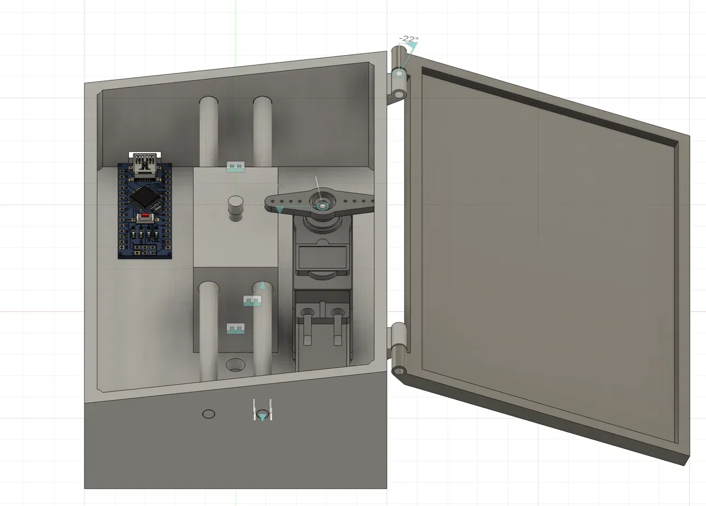

# Servo-Actuated Toggle Switch Mechanism

A 3D-printed retrofit that throws a standard wall toggle switch, mounted over the existing plate with no rewiring. A servo turns a slotted lever, the lever drives a slider on two guide rods, and the slider throws the toggle. An Arduino Nano runs it from an on-device button or an IR remote.

Full write-up, with the assembly explodable in the browser and the measurement sketches it was drawn from: **https://shrihanmalkaram.netlify.app/projects/automated-dorm-light-switch**

## Where it stands

Version 3 is the revision in this repository, and it is not built yet. Version 2 used an SG90, and testing showed it stalling against the roughly 5 N the toggle takes to throw — the slotted-lever slider itself was fine, the servo was the part that could not hold the load. Version 3 answers that with a standard-size servo on a mount sized for the larger body. The lever and its pin are still being redrawn around the larger horn, which is the last piece before it can be printed and assembled.

## What is in this repository

- `Servo-Actuated Toggle Switch Mechanism.step` — the Fusion 360 assembly: backplate, slotted lever, slider and guide rods, servo, Arduino Nano and the switch it mounts over
- `v3-render.png` — the version 3 assembly

The firmware is not here yet.

## Design notes

- Built around measurements taken off the real switch plate — 80.3 mm across, 126 mm tall — so the mechanism clears the toggle through its full throw.
- The slotted lever converts the servo's rotation into the linear travel the toggle needs, which keeps the moving parts down to two.
- Next step after it is mounted: a Raspberry Pi control centre that talks to the Arduino wirelessly, ideally voice-activated.
